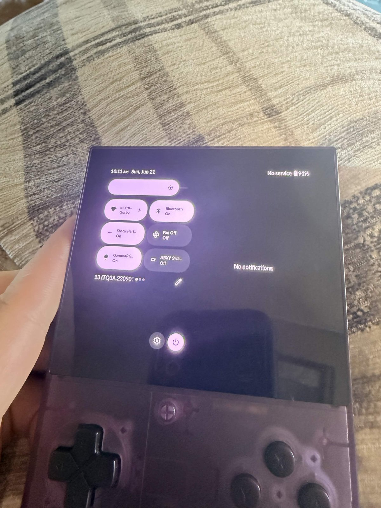
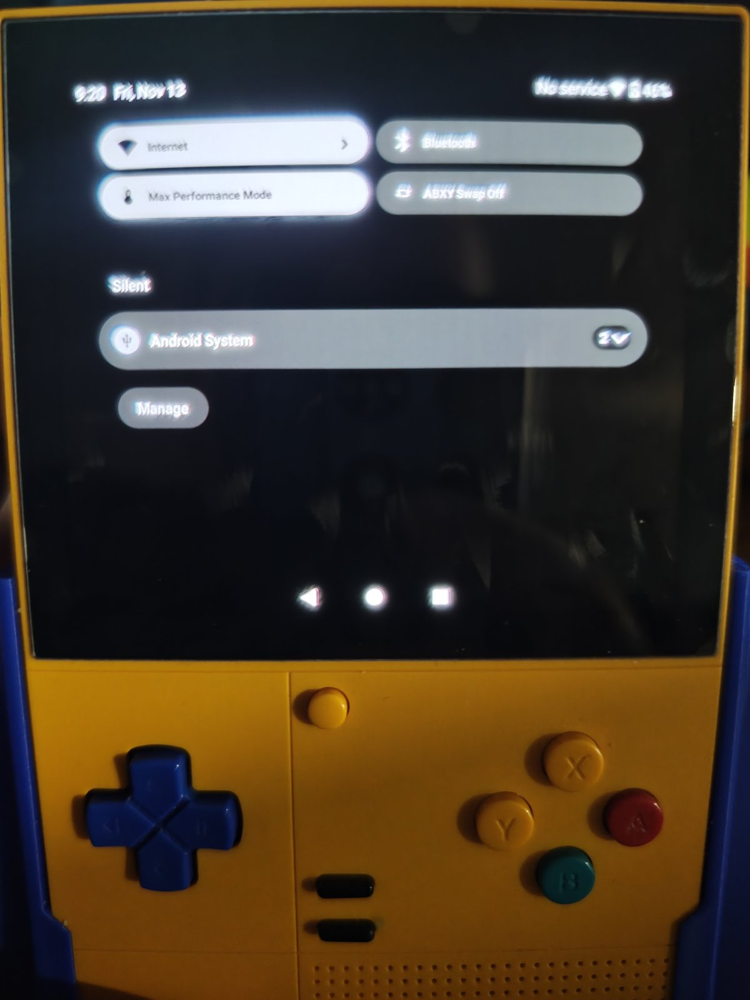

# No Split Shade

A Magisk module that forces the **single-column (phone-style) notification shade**
on Android 13 devices that otherwise show the split, two-panel tablet shade.

It ships a compiled, signed, static Runtime Resource Overlay (RRO) for
`com.android.systemui` that sets `config_use_split_notification_shade` to `false`.
No code, no SystemUI patching; remove the module and you're back to stock.

| | |
|---|---|
| Overlay package | `com.android.systemui.nosplitshade` |
| Target | `com.android.systemui` |
| Type | static RRO (`isStatic=true`, `priority=100`) |
| Install path | `/product/overlay/NoSplitShade.apk` (via Magisk) |
| Tested on | Retroid Pocket Classic, GammaOS Next (Android 13 / LineageOS 20) |

## Why

On GammaOS Next the Retroid Pocket Classic shows a tablet-style split shade:
Quick Settings tiles squeezed into the left half with cut-off labels, and
notifications on the right. For anyone with low vision or larger fingers,
that's hard to read and hard to tap. This module restores the full-width,
phone-style shade. Full story and investigation: **[docs/WRITEUP.md](docs/WRITEUP.md)**.

| Before | After |
|---|---|
|  |  |

## Install

1. Download `NoSplitShade-vX.Y-magisk.zip` from [Releases](../../releases).
2. Magisk app → **Modules** → **Install from storage** → pick the zip.
3. **Full reboot.** Static overlays are only picked up at boot; restarting SystemUI is not enough.

### Verify

```sh
adb shell cmd overlay list com.android.systemui
# expect: [x] com.android.systemui.nosplitshade

adb shell cmd overlay lookup com.android.systemui com.android.systemui:bool/config_use_split_notification_shade
# expect: false
```

### Uninstall

Disable or remove the module in Magisk and reboot. A static overlay can't be
toggled with `cmd overlay enable/disable`.

## How it works

SystemUI decides split vs. single shade in `LargeScreenUtils.shouldUseSplitNotificationShade()`,
which just reads `R.bool.config_use_split_notification_shade`.

Android picks the **most specific matching resource folder across the target app
and all its overlays**. An overlay that only sets `values/` loses to a target that
sets `values-sw480dp-land/`. So this overlay defines `false` in every qualifier
folder the target uses (plus neighbors):

```
values  values-land
values-sw392dp  values-sw392dp-land  values-sw392dp-port
values-sw480dp  values-sw480dp-land  values-sw480dp-port
values-sw600dp  values-sw600dp-land  values-sw600dp-port
values-sw720dp  values-sw720dp-land  values-sw720dp-port
```

Stock AOSP 13 / LOS20 only enables split shade in `sw600dp-land` and `sw720dp-land`.
GammaOS Next ships a modified SystemUI:

```
()             true
(sw480dp)      false
(land)         true
(sw392dp-land) true
(sw480dp-land) true
```

The Retroid Pocket Classic (1240×1080 @ 320 dpi → smallest width 1080×160/320 = 540 dp,
landscape) resolves to `sw480dp-land`, which is why v1.0 (stock folders only) didn't work.

> The overlay also defines the camelCase name `config_useSplitNotificationShade`.
> It doesn't exist in SystemUI and is ignored; it's kept for ROMs that might use it.

## Porting to another device / ROM

1. Pull your SystemUI and dump the bool:
   ```sh
   adb shell pm path com.android.systemui
   adb pull <path>/SystemUI.apk
   aapt2 dump resources SystemUI.apk | grep -A10 config_use_split_notification_shade
   ```
2. Make sure every folder listed there has a matching `res/values-<qualifier>/bools.xml` with `false`.
3. Find your bucket: `adb shell wm size`, `adb shell wm density`,
   smallest width (dp) = min(px) × 160 / dpi.
4. Rebuild, flash, verify with `cmd overlay lookup`.

## Building

Requirements: Linux/macOS/WSL with bash, OpenJDK 17+, Android SDK
`build-tools;34.0.0` (`aapt2`, `zipalign`, `apksigner`) and `platforms;android-33`.

```sh
sdkmanager "build-tools;34.0.0" "platforms;android-33"
export ANDROID_SDK_ROOT=/path/to/sdk     # or ANDROID_HOME
export JAVA_HOME=/path/to/jdk            # optional if java is on PATH
./build.sh
```

Outputs in `out/`: `NoSplitShade.apk`, `NoSplitShade-<ver>-magisk.zip`, `NoSplitShade-<ver>-src.zip`.

Notes:
- `aapt2 link` runs with `--no-resource-deduping --no-resource-removal`. Without them
  aapt2 collapses identical `false` values into `values/` and the overlay loses to
  the target's qualified folders.
- `build.sh` generates a throwaway signing key in `keys/` if none exists. Preinstalled
  `/product` overlays don't need a platform signature. `keys/` is git-ignored.
- Version lives in `build.sh` (`VERSION`), `AndroidManifest.xml`
  (`versionCode`/`versionName`) and `module/module.prop`.

## Repository layout

```
AndroidManifest.xml        overlay manifest (target, priority, isStatic)
res/values*/bools.xml      the overridden bool, one file per qualifier
module/                    Magisk template (module.prop, customize.sh, META-INF)
build.sh                   compile → link → zipalign → sign → package
docs/WRITEUP.md            problem, investigation, fix, verification
docs/images/               before/after photos
```

## Troubleshooting

| Symptom | Cause / fix |
|---|---|
| Overlay not in `cmd overlay list` | Module not mounted or not rebooted. Check `adb logcat \| grep -iE "OverlayManager\|idmap"` during boot, and whether `/product/overlay/config/config.xml` restricts overlays. |
| Listed `[x]` but `lookup` prints `true` | Target sets the bool in a qualifier you don't cover. Dump SystemUI (see Porting) and add folders. |
| Another overlay wins | `cmd overlay list com.android.systemui` — a higher-priority overlay setting the same bool. Raise `android:priority`. |
| `lookup` prints `false` but shade still split | ROM decides split shade in code, not from this bool. An overlay can't fix that. |

## Disclaimer

Modifies system UI behavior via Magisk. Use at your own risk; keep a way to boot
without modules (Magisk safe mode / `adb wait-for-device shell magisk --remove-modules`).

## License

[MIT](LICENSE)
