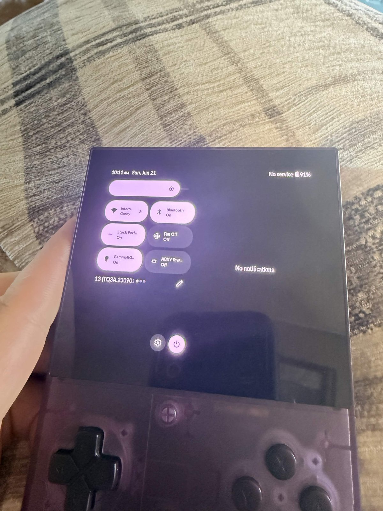
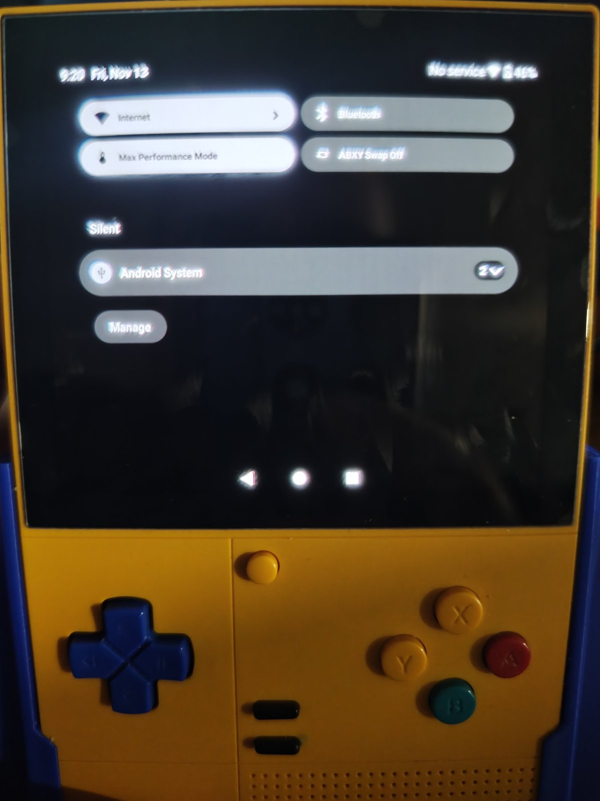

# Write-up: Forcing a single-column notification shade on GammaOS Next (Retroid Pocket Classic)

## Why I built this

I've been running [GammaOS Next](https://github.com/TheGammaSqueeze/GammaOSNext) on my
Retroid Pocket Classic for a while, and one thing kept bothering me: the
**split notification shade**. Quick Settings tiles are squeezed into the left half
of the screen and notifications into the right.

This is an accessibility problem for me. I have an eye condition that makes small
text hard to read, and with my thick fingers the half-width tiles are hard to tap
accurately. On a 3.92" screen, splitting the shade in two halves the usable size of
everything in it.

There's no setting for this in GammaOS. The last official GammaOS Next release
for the Retroid Pocket Classic is
[v1.0.0, released July 15, 2025](https://github.com/TheGammaSqueeze/GammaOSNext/releases/tag/v.1.0.0-RETROIDPOCKETCLASSIC)
(Patreon early access, public August 28, 2025), and there's no announced date
for the next one. Waiting for an upstream fix wasn't realistic, so I used Grok
to research and build a quick Magisk-based fix that doesn't change the ROM itself.

## Before and after

| Before (split shade) | After (single column) |
|---|---|
|  |  |

**Before:** Quick Settings tiles take only the left half of the screen, with
truncated labels ("Intern…", "Stock Perf…", "GammaRG…", "ABXY Swa…"). The right
half is a separate notification panel.

**After:** Tiles go full width with complete labels ("Internet",
"Max Performance Mode", "ABXY Swap Off"), and notifications stack underneath in
one column, the same layout a phone uses.

## Goal

- Force the phone-style single-column shade.
- Don't modify the ROM, SystemUI, or `/system`. Must be fully reversible.
- Survive reboots; quick to remove.

**Approach:** a static Runtime Resource Overlay (RRO) for `com.android.systemui`,
installed to `/product/overlay` by a Magisk module.

## Investigation

### 1. Find the switch

In Android 13 / LineageOS 20, SystemUI decides the layout in
[`LargeScreenUtils.shouldUseSplitNotificationShade()`](https://github.com/LineageOS/android_frameworks_base/blob/lineage-20.0/packages/SystemUI/src/com/android/systemui/util/LargeScreenUtils.kt),
which returns the resource bool **`config_use_split_notification_shade`**.
(Note the snake_case name. `config_useSplitNotificationShade` is not used.)

Stock [LOS20 SystemUI](https://github.com/LineageOS/android_frameworks_base/blob/lineage-20.0/packages/SystemUI/res/values/config.xml)
defaults it to `false` and only sets `true` in `values-sw600dp-land` and
`values-sw720dp-land` (tablets in landscape).

### 2. v1.0: overlay the stock folders. Installed, but didn't work

v1.0 set the bool to `false` in the stock folders. After flashing and rebooting,
the overlay was installed and enabled, but the shade was still split:

```
> adb shell cmd overlay list com.android.systemui
com.android.systemui
[x] com.android.systemui.auto_generated_rro_product__
[x] com.android.systemui.nosplitshade
...
> adb shell cmd overlay lookup com.android.systemui com.android.systemui:bool/config_use_split_notification_shade
true
```

`[x]` only means *enabled*. `cmd overlay lookup` shows the value SystemUI actually
resolves, and it was still `true`. Priority wasn't the problem either: our overlay
(priority 25) already ranked above GammaOS's auto-generated one (priority 23).

### 3. Work out which resource folder the device uses

```
> adb shell wm size
Physical size: 1240x1080
> adb shell wm density
Physical density: 320
```

Smallest width = 1080 px × 160 / 320 dpi = **540 dp**. Width > height, so the device is
**landscape**. That should be below the stock 600 dp threshold, so something in GammaOS
was different.

### 4. Dump the real SystemUI from the device

```
adb pull /system_ext/priv-app/SystemUI/SystemUI.apk
aapt2 dump resources SystemUI.apk | grep -A8 config_use_split_notification_shade
```

```
bool/config_use_split_notification_shade
  ()             true     <- GammaOS default is split (stock LOS20 is false)
  (sw480dp)      false
  (land)         true
  (sw392dp-land) true
  (sw480dp-land) true     <- the Retroid Pocket Classic matches this one
```

GammaOS's SystemUI isn't stock: it enables split shade at 392 dp and 480 dp in
landscape. Android picks the **most specific matching folder across the target
and all its overlays**. SystemUI's `sw480dp-land` is more specific than anything
in v1.0 (`land`, `sw600dp-land`, …), so its `true` won.

**Lesson:** read the resource table of the APK actually on the device, not AOSP source.

## Fix (v1.1)

I added `values-sw392dp*` and `values-sw480dp*` folders (plain, `-land`, `-port`).
The overlay now sets `false` in 14 qualifier folders, covering every folder SystemUI uses:

```
values  values-land
values-sw392dp  values-sw392dp-land  values-sw392dp-port
values-sw480dp  values-sw480dp-land  values-sw480dp-port
values-sw600dp  values-sw600dp-land  values-sw600dp-port
values-sw720dp  values-sw720dp-land  values-sw720dp-port
```

Build gotcha: `aapt2 link` must run with `--no-resource-deduping --no-resource-removal`.
Otherwise aapt2 sees identical `false` values, keeps only `values/`, and the
overlay silently loses again.

I also removed a `vendor_overlay_file` SELinux label from `customize.sh`. Magisk's default
`system_file` context is the correct one for `/product/overlay`.

## Verification

After flashing v1.1 and rebooting:

```
> adb shell cmd overlay lookup com.android.systemui com.android.systemui:bool/config_use_split_notification_shade
false
```

The shade is single-column (see the *After* photo).

## Takeaways

1. An enabled overlay (`[x]`) isn't proof it works. Use `cmd overlay lookup` to
   see the value the app actually reads.
2. Overlays win per configuration, not globally. Cover every qualifier folder the target defines.
3. Custom ROMs change resources. Dump the on-device APK with `aapt2 dump resources`.
4. Compute your device's resource bucket: `sw = min(px) × 160 / dpi`, plus orientation from width vs. height.

## Environment

| | |
|---|---|
| Device | Retroid Pocket Classic (1240×1080, 320 dpi) |
| ROM | GammaOS Next v1.0.0 (Android 13 / LineageOS 20) |
| Root | Magisk |
| Build tools | Android build-tools 34.0.0 (`aapt2`, `zipalign`, `apksigner`), `android-33` platform |
| Host | Windows + `adb` (platform-tools) |
